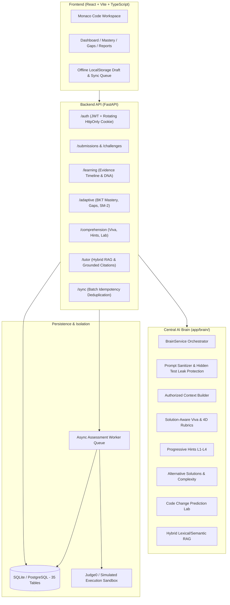

# COGNICODE

**COGNICODE** is an AI-powered adaptive programming learning and code-comprehension platform. It evaluates not only whether a student's code compiles and passes test cases, but whether the student truly understands, can explain, can debug, and can predict modifications to their own code.

---

## Current Platform State

- **Backend Status**: **183 passed** automated pytest tests (0 failed, 0 skipped, 7 warnings in 185s).
- **Frontend Status**: Clean production build (`tsc -b && vite build`) in **590ms** with 0 errors.
- **Database Schema**: Alembic migration `0003_cognicode_adaptive_and_evidence_schema.py` applied to `head` (35 active tables, 0 schema drift).
- **Orchestration**: Unified Central COGNICODE `BrainService` coordinating all AI learning capabilities with strict RBAC, prompt sanitization, hidden test protection, and deterministic fallbacks.

---

## Core Capabilities & Architecture



### 1. Central AI Brain (`app/brain/`)
- Single entry-point orchestrator (`BrainService`) coordinating all semantic learning capabilities.
- Strict isolation of hidden test cases: hidden inputs and outputs are never supplied to AI prompts or student-facing schemas.
- Deterministic fallback guarantees: if LLM provider fails or times out, rule-based rubric scoring and fallback templates ensure zero downtime.

### 2. Evidence Timeline & Learning DNA (`app/services/learning_evidence.py`)
- Structured ledger (`learning_events`) recording code executions, viva responses, hint requests, and mastery changes.
- Persistent Personal Error DNA (`student_error_patterns`) deriving recurring mistakes (loop boundary, array index OOB, boolean condition errors) with confidence scores and tailored remediation advice.

### 3. Adaptive Learning & Prerequisite DAG (`app/services/adaptive.py`)
- Concept taxonomy seeded with 8 core programming concepts in a directed acyclic graph.
- Cycle prevention enforced dynamically via DFS traversal (`CyclicPrerequisiteError`).
- Bayesian Knowledge Tracing (BKT) updating prior knowledge, slips, guesses, and learning transitions.
- Learning-Gap Radar identifying root prerequisite bottlenecks.
- SM-2 Spaced Repetition engine scheduling UTC due dates based on performance ratings (1..5).

### 4. Code Comprehension Suite (`app/api/comprehension.py`)
- Solution-aware viva question generator grounded in submitted code AST.
- 4-dimensional rubric evaluation (Correctness, Reasoning, Connection to Solution, Edge Cases).
- Progressive debugging hints (Level 1: Concept, Level 2: Location, Level 3: Action, Level 4: Concrete).
- Alternative solution explorer with time/space complexity comparisons.
- Code change prediction lab with isolated sandbox mutation validation.
- Failed test diagnostic categorizing runtime, compilation, timeout, or output discrepancies.

### 5. Grounded Hybrid RAG Tutor (`app/services/rag.py`)
- Document ingestion pipeline preserving markdown code blocks and indentation.
- Hybrid lexical search + metadata filtering.
- Strict citation validation: all citations map to actual chunk IDs.
- Insufficient evidence refusal: refuses out-of-domain questions rather than hallucinating.
- 5 tutor modes: `learn`, `debug`, `hint`, `explain_code`, `exam_prep`.

### 6. Offline Support & Synchronization (`app/api/sync.py` & `offlineSync.ts`)
- Client-side code and answer draft persistence surviving browser refresh.
- Offline action queue with client-generated idempotency keys.
- Server-side batch synchronization (`POST /api/v1/sync/batch`) with duplicate replay deduplication.

---

## Local Setup & Quickstart

### Prerequisites
- Python 3.11+ (Python 3.12 / 3.14 verified)
- Node.js 18+ (Node 20+ recommended)

### 1. Backend Setup
```bash
cd backend
python -m venv .venv
# On Windows: .venv\Scripts\activate
# On Linux/macOS: source .venv/bin/activate
pip install -r requirements.txt

# Copy environment template
cp .env.example .env

# Run database migrations (applies revision 0003)
python -m alembic upgrade head

# Seed initial concept taxonomy & demonstration accounts
python -m app.seed
```

### 2. Start Backend & Worker
```bash
# Terminal 1: FastAPI API Server
python -m uvicorn app.main:app --host 127.0.0.1 --port 8000 --reload

# Terminal 2: Background Assessment Worker
python -m app.worker
```
API Documentation: [http://localhost:8000/docs](http://localhost:8000/docs)

### 3. Frontend Setup
```bash
cd Kurushektra-main
npm install
npm run dev
```
Open your browser at [http://localhost:5173](http://localhost:5173).

---

## Demonstration Credentials

Pre-seeded demonstration accounts stored with argon2 password hashes in `dev.db`:

| Role | Email | Password | Access / Capabilities |
| :--- | :--- | :--- | :--- |
| **Student** | `student@example.com` | `Student123!` | Coding workspace, real backend execution, progressive AI hints, alternatives, viva assessment, Learning DNA, concept mastery, gap remediation |
| **Teacher** | `teacher@example.com` | `Teacher123!` | Challenge creation, hidden test case management, RAG knowledge ingestion, student assessment reviews |
| **Admin** | `admin@example.com` | `Admin123!` | Platform configuration, user role management, system diagnostics |

---

## Verification & Testing

### Run Backend Test Suite
```bash
cd backend
python -m pytest
```
*Current result: 183 passed in 185s.*

### Run Frontend Production Typecheck & Build
```bash
cd Kurushektra-main
npm run build
```
*Current result: Built in 590ms with 0 errors.*

---

## Documentation Links

- [`docs/FEATURE_AUDIT.md`](file:///e:/ALL%20HACKTHONS/COGNICODE/Kurushektra/docs/FEATURE_AUDIT.md): Complete feature inventory and classification audit.
- [`docs/IMPLEMENTATION_PLAN.md`](file:///e:/ALL%20HACKTHONS/COGNICODE/Kurushektra/docs/IMPLEMENTATION_PLAN.md): Detailed milestones, acceptance criteria, and dependency graph.
- [`docs/API_CONTRACTS.md`](file:///e:/ALL%20HACKTHONS/COGNICODE/Kurushektra/docs/API_CONTRACTS.md): Standardized request/response schemas for all routes.
- [`docs/ARCHITECTURE.md`](file:///e:/ALL%20HACKTHONS/COGNICODE/Kurushektra/docs/ARCHITECTURE.md): Architecture specifications and ER diagrams.
- [`HANDOFF.md`](file:///e:/ALL%20HACKTHONS/COGNICODE/Kurushektra/HANDOFF.md): Engineering handoff report and startup guide.
