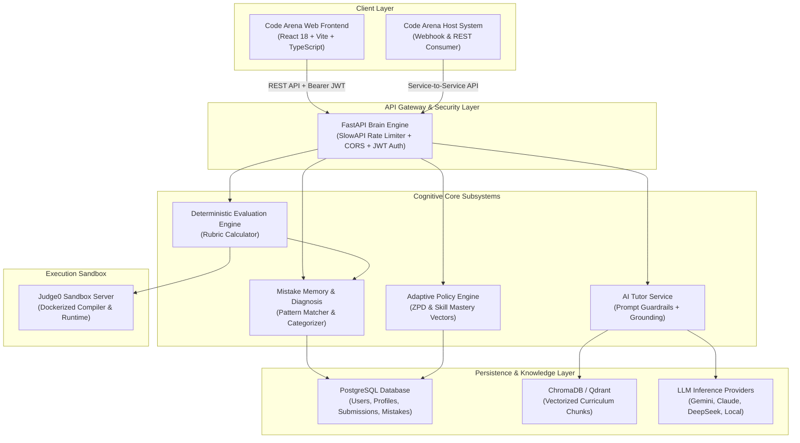

# Code Arena AI Brain — System Architecture Overview

## 1. Executive Summary

The **Code Arena AI Brain** is an integration-ready cognitive engine designed to power adaptive coding education for the Code Arena platform. It couples deterministic rubric-based code execution with vector-grounded Retrieval-Augmented Generation (RAG), persistent mistake diagnosis, and personalized pedagogical interventions.

---

## 2. Architectural Blueprint

---

## 3. Subsystem Breakdown

### 3.1 RAG-Grounded AI Tutoring Subsystem
- **Vector Retrieval**: Embeds queries and retrieves the top-$k$ relevant textbook chunks from the role-isolated curriculum collection.
- **Prompt Injection Defense**: Grounded prompts explicitly instruct the model never to output complete solutions or follow conflicting instructions embedded inside retrieved educational documents.
- **Citations & Transparency**: Every response includes verifiable references to documents, chunk indices, and relevance scores.

### 3.2 Sandboxed Execution & Deterministic Evaluation
- **Judge0 Container Sandbox**: Source code is compiled and executed in strictly isolated worker containers with hard memory (128 MB), CPU time (2.0s), and wall-clock time (5.0s) limits.
- **Hidden Test Isolation**: Expected outputs of hidden test cases are evaluated server-side and never exposed over client network payloads.
- **Deterministic Rubrics**: Scoring is mathematically computed from test pass ratios and execution constraints. AI models never assign raw grades.

### 3.3 Mistake Memory & Diagnostics
- **Categorization**: Classifies run-time, logical, and compilation failures into pedagogical categories: `OFF_BY_ONE`, `RECURSION_BASE_CASE`, `NULL_POINTER`, `TIME_LIMIT_EXCEEDED`, `SYNTAX_ERROR`.
- **Persistent Student Vector**: Retains diagnosis history to differentiate transient syntax slips from persistent conceptual misconceptions.

### 3.4 Adaptive Learning Policy
- **Zone of Proximal Development (ZPD)**: Evaluates student mastery scores and failure streaks.
- **Intervention Typology**:
  - `practice_easier`: De-escalates difficulty after consecutive failures.
  - `hint_scaffolding`: Provides incremental structural hints.
  - `concept_review`: Links to targeted curriculum chapters before re-attempting.
  - `challenge_next`: Recommends higher-tier problems upon consistent mastery (score $\ge 80\%$).

---

## 4. Integration Guidelines for Host Code Arena System

The AI Brain module can be integrated into an existing Code Arena deployment through:
1. **Shared Database or Webhooks**: Host Code Arena can forward code submission events to `POST /api/v1/submissions`.
2. **Reverse Proxy / Microservice Route**: Mount `/api/v1` behind the existing gateway (Nginx, Kong, or Envoy).
3. **SSO / JWT Compatibility**: Accepts user identity either via Bearer JWT tokens or trusted gateway identity headers (`X-AI-Brain-User-ID`, `X-AI-Brain-User-Role`, `X-AI-Brain-User-Email`).
