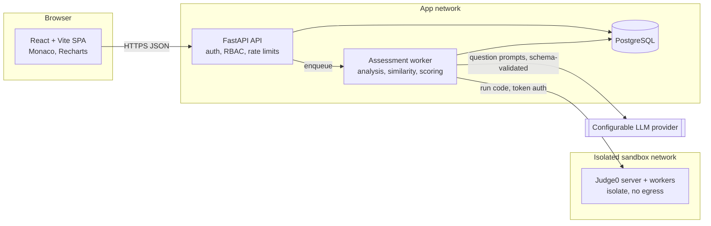
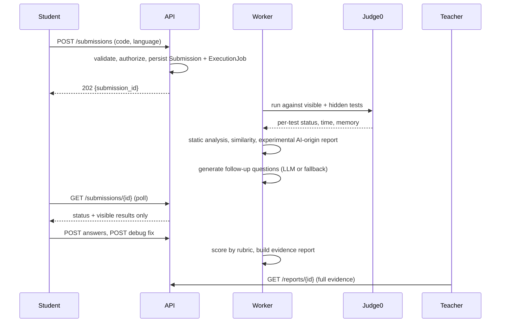
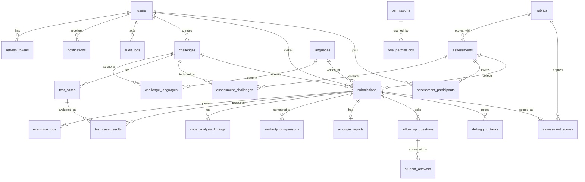

# CodeArena architecture

## System overview



Key boundaries:

- Student code never runs in the API process. Only the worker talks to Judge0, and Judge0's token never reaches the browser.
- The LLM is optional. If it times out, errors, or returns schema-invalid output, deterministic fallback questions are used.
- Hidden test cases are read only by the worker and by teacher/admin schemas. Student response models do not declare fields for hidden input or expected output.
- AI-origin analysis is stored in its own table and is excluded from `assessment_scores` by design.

## Submission sequence (implemented across phases 3 to 6)



## Entity relationship diagram



Notes on the schema (`backend/app/models`, migration `0001_initial_schema`):

- UUID string primary keys, `created_at`/`updated_at` where records change.
- Enums are stored as VARCHAR with CHECK constraints so the same migration runs on PostgreSQL and SQLite (tests).
- Uniqueness: user email, challenge slug, `(challenge, language)`, `(assessment, participant)`, `(submission, test case)` results, similarity `(a, b, method)`, one score and one AI-origin report per submission.
- `challenges.is_fixture` marks seed/sample data so it can be told apart from real assessment data.
- `refresh_tokens` stores a hash only.
- `debugging_tasks` keeps `original_code` and `modified_code` apart from `submissions.source_code`, which is never edited.
## COGNICODE Central AI Brain & Subsystems

```mermaid
flowchart TD
    subgraph UI[React + TypeScript SPA (Kurushektra-main)]
      CW[Coding Workspace]
      LG[Learning Gap Radar]
      MP[Mastery Path]
      LR[Learner Report]
      RT[RAG Tutor]
      OFS[Offline Sync Manager]
    end

    subgraph API[FastAPI Gateway]
      direction TB
      AUTH[Auth & RBAC]
      SUB[Submissions & Execution API]
      COMP[Comprehension API]
      ADAP[Adaptive Engine API]
      LEVN[Learning Timeline & DNA API]
      TUTR[Tutor API]
      SYNC[Sync Endpoint]
    end

    subgraph Brain[Central COGNICODE BrainService]
      direction TB
      CTX[Context Builder & Permission Filter]
      PROV[Provider Interface & Fallback Engine]
      VIVA[Solution-Aware Viva]
      EVAL[Rubric Answer Evaluator]
      HINT[Progressive Hint Engine]
      ALT[Alternative Solution Explorer]
      PRED[Code Prediction Lab]
      DIAG[Failure Diagnostic Engine]
    end

    subgraph AdaptiveSystem[Adaptive & Evidence Layer]
      BKT[Bayesian Knowledge Tracing]
      DAG[Concept Prerequisite DAG]
      DNA[Personal Error DNA Engine]
      SRS[Spaced-Repetition Scheduler]
    end

    subgraph Storage[PostgreSQL / SQLite Storage]
      MIG[(Alembic Migrations)]
      EVT[(Learning Events & DNA)]
      MST[(Concepts, DAG, Mastery)]
      KB[(Knowledge Docs & Chunks)]
    end

    UI --> API
    API --> Brain
    API --> AdaptiveSystem
    Brain --> Storage
    AdaptiveSystem --> Storage
```

### Architectural Principles

1. **One Brain, Specialized Capabilities**: All AI-assisted features (viva generation, answer evaluation, progressive hints, code predictions, tutor chat) route through `app.brain.service.BrainService`.
2. **Context Built from Trusted Records Only**: The context builder checks caller identity and strictly excludes hidden test cases, expected hidden answers, and other students' submissions.
3. **Deterministic Core**: Code execution, grading, test results, and mastery estimates are calculated deterministically. AI interpretations are stored separately from authoritative records.
4. **Resilient Fallback**: If LLM providers are unavailable or return malformed JSON, deterministic fallbacks ensure student progression is never blocked.
5. **Idempotent Background Jobs & Safe Offline Sync**: Submissions and sync batches use idempotency keys to prevent duplicate execution or state corruption.

