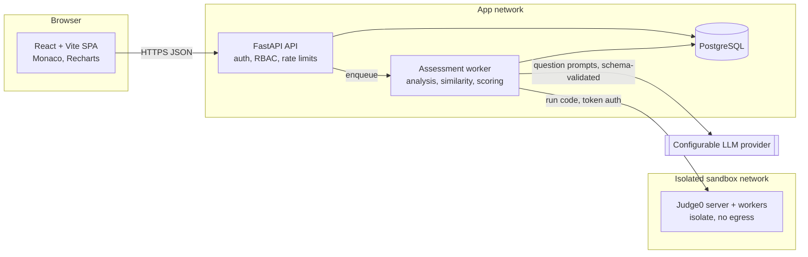
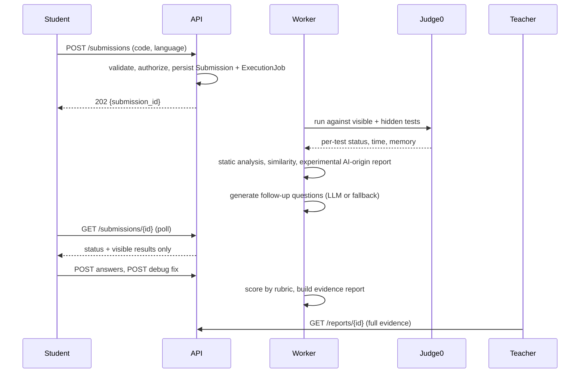
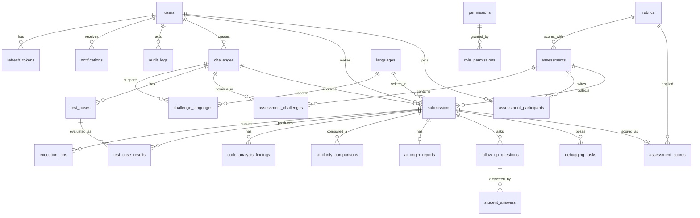

# CodeArena architecture

## System overview



Key boundaries:

- Student code never runs in the API process. Only the worker talks to Judge0, and Judge0's token never reaches the browser.
- The LLM is optional. If it times out, errors, or returns schema-invalid output, deterministic fallback questions are used.
- Hidden test cases are read only by the worker and by teacher/admin schemas. Student response models do not declare fields for hidden input or expected output.
- AI-origin analysis is stored in its own table and is excluded from `assessment_scores` by design.

## Submission sequence (implemented across phases 3 to 6)



## Entity relationship diagram



Notes on the schema (`backend/app/models`, migration `0001_initial_schema`):

- UUID string primary keys, `created_at`/`updated_at` where records change.
- Enums are stored as VARCHAR with CHECK constraints so the same migration runs on PostgreSQL and SQLite (tests).
- Uniqueness: user email, challenge slug, `(challenge, language)`, `(assessment, participant)`, `(submission, test case)` results, similarity `(a, b, method)`, one score and one AI-origin report per submission.
- `challenges.is_fixture` marks seed/sample data so it can be told apart from real assessment data.
- `refresh_tokens` stores a hash only.
- `debugging_tasks` keeps `original_code` and `modified_code` apart from `submissions.source_code`, which is never edited.

## Repository layout

```
codearena/
├── backend/
│   ├── app/{core,api,models}/    config, DB, routers, SQLAlchemy models
│   ├── alembic/                  migrations
│   └── tests/                    pytest
├── frontend/
│   └── src/{components,pages,lib}/
├── docs/ARCHITECTURE.md
├── docker-compose.yml            db + api + web
├── docker-compose.judge0.yml     sandbox (untested)
└── .env.example
```

Planned additions: `backend/app/{services,workers,schemas}`, `backend/app/services/{execution,analysis,similarity,ai_origin,questions,debugging,scoring}`.

## Plan
 
| Phase | Scope | Status |
|---|---|---|
| 1 | Architecture, schema, migration, design system, landing page | Done |
| 2 | Auth (argon2, JWT access + refresh), RBAC, challenge CRUD, seed fixtures | Done |
| 3 | Monaco workspace, submission API, Judge0 integration | Done (sandbox verified against a mock only) |
| 4 | Static analysis, similarity, report endpoints | Done |
| 5 | Follow-up question engine & student answering workflow, debugging engine | Question engine complete; debugging engine next |
| 6 | Rubric scoring, teacher review, analytics | Rubrics & answer schema defined; scoring pipeline next |
| 7 | Hardening, Playwright E2E, deployment docs | |

