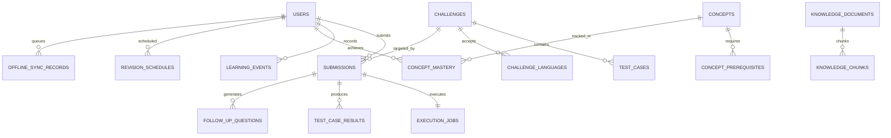

# COGNICODE — Database Design & Scaling Architecture

**Document Version**: 2.0.0  
**Status**: Approved & Implemented  
**Engine Target**: PostgreSQL 16+ (Production) / SQLite with WAL & Foreign Keys (Local Dev & Unit Tests)  
**Schema Head**: Alembic Revision `0004` (`0004_add_missing_model_indexes.py`)

---

## 1. Domain-Driven Database Architecture

COGNICODE organizes data into nine strictly delineated architectural domains. Every domain balances relational integrity with targeted semi-structured metadata for dynamic pedagogical features.



### Domain 1: Identity, Authentication & Audit
- `users`: Core identity table with immutable ID, role enum (`student`, `teacher`, `admin`), Argon2id/bcrypt hashed passwords, and active state flags.
- `refresh_tokens`: Rotated cryptographically random tokens stored as SHA-256 hashes with expiration and revocation metadata. Replay attacks trigger immediate family revocation.
- `audit_logs`: Immutable security log capturing high-privilege operations (`submission.review`, `admin.role_change`, `auth.login`). Contains client IP, user agent, target entity, and action descriptor.

### Domain 2: Challenges, Languages & Test Suites
- `languages`: Language runtime metadata (`key`, `display_name`, `judge0_language_id`, `version_info`, `is_enabled`).
- `challenges`: Authoring entity with difficulty enum (`easy`, `medium`, `hard`), markdown description, fixture flags, and creator ID.
- `challenge_languages`: Many-to-many relationship defining valid language runtimes per challenge.
- `test_cases`: Test input, expected output, timeout bounds, memory bounds, and `is_hidden` boolean flag. Hidden tests are strictly excluded from student APIs.

### Domain 3: Submission Lifecycle & Execution Jobs
- `submissions`: Records source code, language, submission timestamp, status enum (`queued`, `running`, `completed`, `failed`), and run-only flag.
- `execution_jobs`: Asynchronous queue state table tracking worker lease ownership (`worker_id`), `started_at`, `retry_count`, `max_retries`, and error messages.
- `test_case_results`: Individual test execution metrics (`runtime_ms`, `memory_kb`, `status`, `output_excerpt`).

### Domain 4: Learning Evidence & Learning DNA
- `rubrics`: Multidimensional grading weights (`correctness_weight`, `quality_weight`, `followup_weight`, `debugging_weight`).
- `learning_events`: High-frequency append-heavy telemetry stream recording student milestones (`challenge_opened`, `submission_created`, `code_executed`, `viva_answered`, `telemetry_recorded`).
- `student_error_patterns`: Aggregated diagnostic error taxonomy (`category`, `confidence`, `occurrence_count`, `remediation_advice`).

### Domain 5: Adaptive Learning & Concept Hierarchy (DAG)
- `concepts`: Atomic programming competencies (`slug`, `name`, `category`, `difficulty`, `target_depth`).
- `concept_prerequisites`: Directed Acyclic Graph (DAG) edges modeling prerequisite dependencies with cycle detection.
- `concept_mastery`: Student competence modeled via Bayesian Knowledge Tracing parameters ($P(L_0), P(T), P(S), P(G)$) and mastery scores.
- `revision_schedules`: SuperMemo SM-2 spaced repetition schedules with dynamic interval and ease factor adjustments.

### Domain 6: Code Comprehension & Prediction Lab
- `code_prediction_tasks`: AST-mutated code challenges presented to students to test behavioral prediction skills.
- `code_prediction_attempts`: Recorded student output predictions, actual execution output, differences, and scores.

### Domain 7: Hybrid RAG Knowledge Base
- `knowledge_documents`: Course syllabus and verified pedagogical materials with course, topic, and access scope.
- `knowledge_chunks`: Code-preserving chunked passages with extracted keywords and document foreign keys.

### Domain 8: Offline Synchronization & Idempotency
- `offline_sync_records`: Client offline action log capturing `idempotency_key`, `user_id`, `action_type`, `client_timestamp`, and `payload_json`. Prevents duplicate action replay across network reconnections.

### Domain 9: Cohort Assessments
- `assessments`: Timed classroom assessments with scheduled start/end times and access tokens.
- `assessment_challenges`: Challenges assigned to an assessment with ordering.
- `assessment_participants`: Student enrollment and completion status.
- `assessment_scores`: Graded rubric results and cumulative scores.

---

## 2. Relational Integrity vs Flexible Metadata

### Schema Policy
1. **Relational Entities for Core State**: All entities governing permissions, grading, submission statuses, and financial/audit integrity use normalized relational tables with explicit foreign keys and non-null constraints.
2. **Constrained JSON for Dynamic Payloads**: JSON/JSONB is reserved strictly for variable pedagogical payloads:
   - `learning_events.metadata_json`: Key-value telemetry payload validated against `LearningEventIn`.
   - `offline_sync_records.payload_json`: Queued action parameters.
   - `follow_up_questions.expected_points`: Structured answer grading criteria list.
3. **No Unvalidated Schemas**: All JSON fields written by API endpoints pass through Pydantic V2 schema validation before persistence.

---

## 3. Data Partitioning, Retention & GDPR Compliance

### Logical & Time-Based Partitioning
- **`learning_events` Partitioning Strategy**:
  In high-volume deployments (>1M events/month), `learning_events` utilizes PostgreSQL declarative range partitioning by `timestamp` (monthly partitions: `learning_events_y2026m10`, etc.).
- **`offline_sync_records` Retention**:
  Records older than 90 days with status `applied` or `duplicate` are pruned automatically via scheduled maintenance worker sweeps.

### Student Privacy & Data Deletion (GDPR)
1. **Right to Erasure (Soft-Delete & Anonymization)**:
   - User account deletion anonymizes `users` (`full_name = "Deleted Learner"`, `email = "deleted-<uuid>@anonymized.local"`, `password_hash = "*"`).
   - Foreign keys on `submissions`, `learning_events`, and `concept_mastery` specify `ON DELETE CASCADE` where applicable, or preserve anonymized historical scores for classroom analytics without identifying information.
2. **Cross-Tenant & Cross-Student Isolation**:
   - Every read and write query on learner endpoints applies an explicit `user_id == current_user.id` filter.
   - Submissions made by other learners return `404 Not Found` rather than `403 Forbidden` to prevent object existence enumeration.

---

## 4. Connection Pool Budgeting & Database Engine Settings

### PostgreSQL Production Configuration
```python
engine_kwargs = {
    "pool_size": 15,          # Persistent connections per API replica
    "max_overflow": 25,       # Burst connections under peak challenge load
    "pool_recycle": 1800,     # Recycle connections every 30 minutes to prevent stale NAT drops
    "pool_timeout": 30,       # Fail fast if pool exhausted (prevents worker lockup)
    "pool_pre_ping": True,    # Heartbeat ping before checkout prevents broken pipe errors
}
```

### Connection Budgeting Math
For a Kubernetes deployment running 4 API replicas and 2 worker replicas:
$$\text{Max DB Connections} = (4 \times 40) + (2 \times 10) = 180 \text{ connections}$$
PostgreSQL `max_connections` is tuned to `250`, providing headroom for administrative migrations and PgBouncer connection pooling.

### SQLite Development Optimizations
- Multi-threaded access enabled via `check_same_thread=False`.
- Foreign key constraint checks strictly enforced on every connection via event listener:
  `PRAGMA foreign_keys=ON;`
- Write-Ahead Logging (WAL) enabled for non-blocking concurrent reads during local tests.
